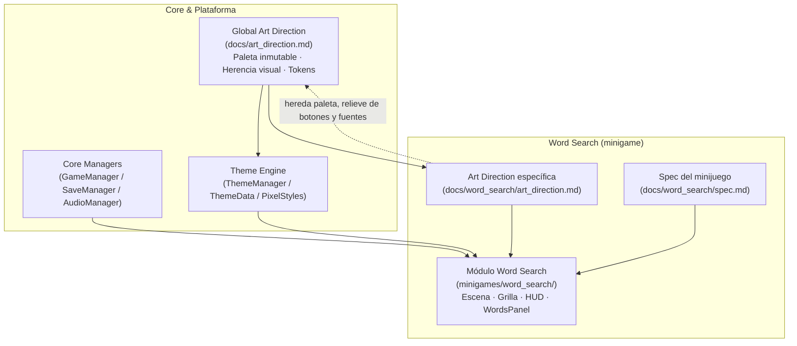

# Clásicos Mente Activa 2D


-478cbf)


Colección de minijuegos de agilidad mental para Godot 4 orientada a adultos (40+), con foco en accesibilidad, legibilidad y experiencia sin frustración. El módulo principal implementado actualmente es **Sopa de Letras (Word Search)**, diseñado para ejecutarse en vista móvil vertical y alinearse a especificaciones y dirección de arte jerárquicas (SDD).

- **Viewport objetivo:** 360×640 (portrait, `canvas_items`)
- **Stack:** Godot 4.x · C# (.NET)
- **Documentación fuente (SoT):** [`docs/spec.md`](docs/spec.md), [`docs/art_direction.md`](docs/art_direction.md), [`docs/word_search/`](docs/word_search/)

## Arquitectura (visión general)



## Decisiones Clave de Arquitectura

### Clean Architecture & DDD
- **Separación de responsabilidades:** lógica de dominio/juego desacoplada de UI y presentación (nodos Godot como composición, lógica en C#).
- **Composición sobre acoplamiento:** patrones y componentes reutilizables (p. ej. factories, contenedores, estilos centralizados) alineados a la jerarquía nativa de Godot.
- **Modelado por contexto:** cada minijuego encapsula sus reglas y métricas en su módulo y documentación específica, heredando estándares globales.

### Spec-Driven Development (SDD)
- Las decisiones de producto, UI y comportamiento se gobiernan por especificaciones y dirección de arte antes/durante la implementación.
- **Jerarquía:** spec global y dirección de arte global como autoridad; specs/art direction por minijuego extienden sin redefinir tokens globales (paleta, tipografía, relieve base).
- Referencias visuales (p. ej. `docs/word_search/wathersoup.jpg`) se usan para verificación de fidelidad 1:1 en editor/dispositivo.

### SemVer 2.0
- Versionado **MAJOR.MINOR.PATCH** (`2.0.0` línea base del proyecto).
- Incrementos de versión reflejan compatibilidad y alcance del cambio (breaking/features/fixes) de forma explícita y trazable.

## Quick Start Guide

### Prerrequisitos
- **Godot 4.x (.NET)** con soporte C# (binario Mono/.NET, no el estándar).
- **.NET SDK** compatible con el proyecto (`net8.0`, ver `ClasicosMenteActiva2D.csproj`).
- Entorno Linux/macOS/Windows con dependencias gráficas para ejecutar el editor o tests headless según tu setup.

### Clonar y ejecutar
```bash
git clone <repo-url>
cd <repo-folder>
```
1. Abre el proyecto en **Godot 4.x .NET** (`project.godot`).
2. Ejecuta la escena principal (configuración portrait **360×640**).
3. Para iterar en UI/arte, contrasta con la [Dirección de Arte Global](docs/art_direction.md) y la de [Word Search](docs/word_search/art_direction.md).

### Pruebas
```bash
# Ruta al binario de Godot .NET (ajusta a tu instalación)
export GODOT_BIN="$HOME/path/to/Godot_v4.x-stable_mono_linux_x86_64/Godot_v4.x-stable_mono_linux.x86_64"
dotnet test
```
- `GODOT_BIN` debe apuntar al **binario Godot .NET**, no al estándar.
- Más detalles en [`tests/README.md`](tests/README.md).

## Documentación
- [Guías para agentes](agents.md)
- [Especificación global](docs/spec.md)
- [Dirección de arte global (paleta, herencia, índice)](docs/art_direction.md)
- [Word Search — spec, plan, art direction, pruebas](docs/word_search/)
- [Pruebas](tests/README.md)

## Licencia
Badge indicado como **MIT** según la política solicitada del repositorio. Si se requiere distribución formal, añadir un archivo `LICENSE` con el texto canónico correspondiente.
